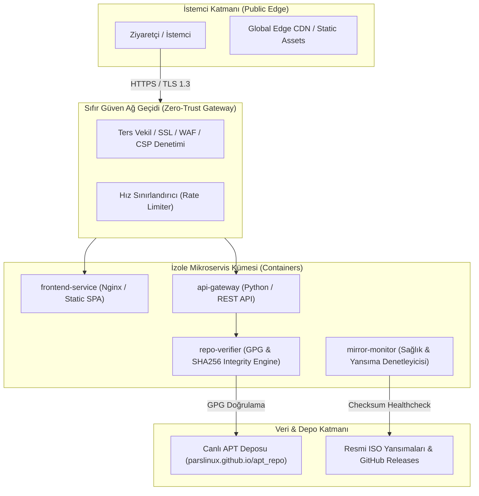

# 🌐 ParsLinux Web Platformu (Official Web & Microservices)

[-0ea5e9?style=for-the-badge&logo=linux&logoColor=white)](https://github.com/parslinux)
[-10b981?style=for-the-badge&logo=shield&logoColor=white)](#-s%C4%B1f%C4%B1r-g%C3%BCven-zero-trust-g%C3%BCvenlik-modeli)
[](#-%C3%A7ok-katmanl%C4%B1-mikroservis-mimarisi)
[](LICENSE)

**ParsLinux Web Platformu**, Türkiye'nin ve dünyanın dört bir yanındaki kullanıcılar için geliştirilen **ParsLinux 1.0 (Anatolian)** işletim sisteminin modern, yüksek performanslı, **Mikroservis** tabanlı ve **Sıfır Güven (Zero-Trust)** güvenlik felsefesiyle inşa edilmiş resmi web vitrinidir.

---

## 📑 İçindekiler

- [Mimarî Genel Bakış](#-mimar%C3%AE-genel-bak%C4%B1%C5%9F)
- [Sıfır Güven (Zero-Trust) Güvenlik Modeli](#-s%C4%B1f%C4%B1r-g%C3%BCven-zero-trust-g%C3%BCvenlik-modeli)
- [Çok Katmanlı Mikroservis Mimarisi](#-%C3%A7ok-katmanl%C4%B1-mikroservis-mimarisi)
- [Öne Çıkan Özellikler](#-%C3%B6ne-%C3%A7%C4%B1kan-%C3%B6zellikler)
- [Teknoloji Yığını](#-teknoloji-y%C4%B1%C4%9F%C4%B1n%C4%B1)
- [Dizin Yapısı](#-dizin-yap%C4%B1s%C4%B1)
- [Hızlı Başlangıç](#-h%C4%B1zl%C4%B1-ba%C5%9Flang%C4%B1%C3%A7)
- [Dokümantasyon Bağlantıları](#-dok%C3%BCmantasyon-ba%C4%9Flant%C4%B1lar%C4%B1)
- [Topluluk ve Katkı](#-topluluk-ve-katk%C4%B1)

---

## 🏛️ Mimarî Genel Bakış

Platform; istemci, API ağ geçidi, paket doğrulama servisi ve depo yansıları arasında **hiçbir varsayılan güven bağı kabul etmeyen**, bağımsız ölçeklenebilir mikroservisler halinde kurgulanmıştır.



---

## 🛡️ Sıfır Güven (Zero-Trust) Güvenlik Modeli

*"Never Trust, Always Verify"* (Asla Güvenme, Daima Doğrula) temel ilkesi altında sistem şu güvenlik katmanlarıyla korunur:

1. **Sıfır Telemetri ve Sıfır Bilgi (Zero-Knowledge):**
   - Kullanıcıların IP adresleri, tarayıcı parmak izleri veya donanım bilgileri sunucu tarafında kesinlikle kaydedilmez.
   - Donanım uyumluluk testi tamamen istemci tarafında (Client-Side Sandboxed JavaScript) işlenir.
2. **Kriptografik Bütünlük Doğrulaması:**
   - İndirilen tüm ISO kalıpları ve `.deb` paketleri resmi GPG anahtarı (`parslinux-archive-keyring.gpg`) ve SHA256 karmaları ile her aşamada denetlenir.
3. **Katı İçerik Güvenlik Politikası (Strict CSP & SRI):**
   - `Content-Security-Policy`, `X-Content-Type-Options: nosniff`, `X-Frame-Options: DENY` başlıkları zorunludur.
   - Dış CDN'lerden çağrılan tüm kütüphaneler (Lucide, VanillaTilt, Confetti) Subresource Integrity (SRI) ile kilitlenir.
4. **İzole Konteynerleşme ve En Az Yetki Prensibi (Least Privilege):**
   - Tüm servisler `root` kullanıcısı olmadan, `read-only` dosya sistemi yetkisiyle izole konteynerlerde (Docker/Podman) çalışır.
5. **Girdilerin Sıkı Doğrulanması (Input Sanitization):**
   - Canlı paket arama ve API istekleri XSS/Injection saldırılarına karşı filtrelenir.

---

## 🧩 Çok Katmanlı Mikroservis Mimarisi

| Servis Adı | Port | Görev ve Sorumluluk | İzolasyon Seviyesi |
| :--- | :--- | :--- | :--- |
| **`frontend-service`** | `8088 / 80` | Ultra hafif SPA (HTML <50 satır), modüler ES6 bileşenleri, 3D cam efektleri | Salt Okunur / Statik |
| **`backend-service`** | `8000` | Python FastAPI Mikroservisi: Canlı APT depo senkronizasyonu, yansıma gecikme testi, sıfır-güven indirme sayacı | Sınırlı Kullanıcı (UID 1000) |
| **`repo-verifier`** | `İç Ağ` | GPG imzalarının ve SHA256 doğrulama kodlarının periyodik denetimi | RFC822 Ayrıştırıcı Modülü |
| **`mirror-monitor`** | `İç Ağ` | GitHub Pages CDN ve resmi yansımaların ping/gecikme testi | Asenkron HTTPX İşçisi |

---

## ⚡ Öne Çıkan Özellikler

- 🌌 **Fütüristik Görsel Deneyim:** Özel üretilmiş siber Anadolu Parsı duvar kağıdı (`pars-default.png`), 8K GNOME & XFCE arayüz mockup'ları.
- 🐍 **Python FastAPI Mikroservisi:** `parslinux.github.io/apt_repo` deposundaki RFC822 `Packages` dosyasını anlık çekip 31+ paketi API ve Swagger (`/docs`) üzerinden sunar.
- ⚡ **Modüler JavaScript (ES6+ Modules):** `js/data`, `js/services` ve `js/components` modülleri ile tek sorumluluk prensibi, yüksek bakım kolaylığı.
- 🔐 **Tarayıcı İçi SHA-256 Doğrulayıcı:** Web Crypto API (`crypto.subtle.digest`) ile ISO dosyasını sunucuya yüklemeden %100 yerel sağlama doğrulaması.
- 💻 **Donanım Algılayıcı ve Uyumluluk:** İstemci tarafında WebGL, CPU çekirdeği ve RAM okuyup GNOME / XFCE önerisi üreten algoritma.
- 🌐 **Çoklu Dil Motoru (TR 🇹🇷 / EN 🇬🇧):** Tüm arayüzü, indirme merkezini ve paket açıklamalarını tek tıkla dönüştüren hafif i18n altyapısı.
- 💾 **Resmi İndirme Merkezi Modalı:** GNOME (3.1 GB) ve XFCE (2.4 GB) sürümleri için doğrudan HTTPS, Torrent ve terminal SHA256 doğrulama komutu üreteci.
- 🎨 **Modern Açık Kaynak Kütüphaneler:** Lucide Icons, VanillaTilt 3D kart eğilme efektleri ve kutlama konfeti motoru.
- ✨ **60 FPS Ambient Starfield:** Arka planda donanımı yormayan, pürüzsüz yıldız parçacığı canvas animasyonu.

---

## 🛠️ Teknoloji Yığını

* **Ön Yüz (Client):** HTML5 (<50 satır mount root), Modern CSS3 (CSS Değişkenleri, Glassmorphism), Modüler Vanilla JavaScript (ES6 Modules).
* **İkon & Etkileşim:** [Lucide Icons](https://lucide.dev/), [VanillaTilt.js](https://micku7zu.github.io/vanilla-tilt.js/), [Canvas Confetti](https://www.kirilv.com/canvas-confetti/).
* **Arka Yüz (Microservice):** Python 3.10+ (FastAPI, Uvicorn, HTTPX Asenkron İstemci, Pydantic).
* **Konteyner & Dağıtım:** Docker, Docker Compose (Rootless, `read_only`, `cap_drop: ALL`).

---

## 📁 Dizin Yapısı

```
web_sayfasi/
├── index.html            # Ultra hafif montaj kökü (<50 satır, ~2.5 KB)
├── styles.css            # Kapsamlı cam efektli koyu tasarım sistemi (Design System)
├── js/                   # Modüler ES6+ JavaScript Mimarisi
│   ├── main.js           # Ana uygulama yöneticisi, durum (state) ve olay yönetimi
│   ├── data/
│   │   ├── i18n.js       # TR / EN çift dil sözlüğü ve çeviri motoru
│   │   └── packages.js   # Çevrimdışı/yedek paket kataloğu
│   ├── services/
│   │   ├── live-repo.js  # FastAPI / GitHub Pages canlı APT köprüsü
│   │   ├── crypto-verifier.js # Tarayıcı içi Web Crypto SHA-256 doğrulayıcı
│   │   ├── hardware-prober.js # İstemci tarafı CPU/RAM/GPU tespit modülü
│   │   ├── toast.js      # Bildirim sistemi
│   │   └── canvas.js     # 60 FPS yıldız alanı motoru
│   └── components/       # 14 Bağımsız UI Bileşeni
│       ├── navbar.js, hero.js, stats.js, features.js, editions.js,
│       ├── comparison.js, suite.js, checker.js, repo.js, packages.js,
│       └── guide.js, downloads.js, faq.js, footer.js, modal.js
├── backend/              # Python FastAPI Mikroservisi
│   ├── main.py           # FastAPI rotaları, Swagger UI (/docs) ve CORS
│   ├── config.py         # Depo bağlantıları, yansımalar ve güvenlik ayarları
│   ├── requirements.txt  # fastapi, uvicorn, httpx, pydantic
│   ├── Dockerfile        # Rootless çok aşamalı mikroservis imajı
│   └── services/
│       ├── apt_parser.py # Debian RFC822 Packages dosyasını asenkron okuma
│       ├── mirror_monitor.py # Yansıma ping ve gecikme testi servisi
│       └── privacy_counter.py # Sıfır bilgi tuzlu (salted) indirme sayacı
├── assets/
│   ├── icons/            # Vektörel SVG logoları
│   └── images/
│       ├── pars-default.png            # Resmi siber Anadolu Parsı duvar kağıdı
│       ├── parslinux-hero-desktop.jpg  # GNOME 8K masaüstü konsepti (*Temsili)
│       └── parslinux-xfce-desktop.jpg  # XFCE 4.18 hafif masaüstü konsepti (*Temsili)
├── docker-compose.yml    # Frontend (8088) ve Backend (8000) orkestrasyonu
├── progress.md           # Adım adım faz ilerleme raporu
├── install.md            # Sıfırdan kurulum ve sıfır güven kılavuzu
└── README.md             # Proje ana tanıtım belgesi
```

---

## 🚀 Hızlı Başlangıç

### 1. Yerel Geliştirme (Python ile Ön Yüz + Arka Yüz)

```bash
# Terminal 1 - Python FastAPI Mikroservisi:
cd /home/can/Masaüstü/proje/mcsm/masaüstü/web_sayfasi
source .venv/bin/activate
uvicorn backend.main:app --host 127.0.0.1 --port 8000 --reload

# Terminal 2 - Ön Yüz Statik Sunucusu:
python3 -m http.server 8088
```

- 🌐 Ön Yüz Arayüzü: `http://localhost:8088/`
- ⚡ Swagger API Dokümantasyonu: `http://127.0.0.1:8000/docs`

### 2. Mikroservis / Konteyner ile Başlatma (Docker Compose)

```bash
# Frontend ve Backend mikroservislerini sıfır güven modunda başlatın:
docker compose up -d --build
```

---

## 📖 Dokümantasyon Bağlantıları

- 📋 [İlerleme Raporu (`progress.md`)](file:///home/can/Masaüstü/proje/mcsm/masaüstü/web_sayfasi/progress.md)
- 📦 [Kurulum ve Dağıtım Kılavuzu (`install.md`)](file:///home/can/Masaüstü/proje/mcsm/masaüstü/web_sayfasi/install.md)
- 📦 [Canlı ParsLinux APT Deposu](https://parslinux.github.io/apt_repo/)
- 🐙 [Resmi ParsLinux GitHub Organizasyonu](https://github.com/parslinux)

---

## 🤝 Topluluk ve Katkı

ParsLinux Web Platformu özgür yazılım topluluğunun katkılarıyla gelişir.
- Hata bildirmek için: [GitHub Issues](https://github.com/parslinux/parslinux/issues)
- Lisans: **GNU General Public License v3 (GPL v3)**.
